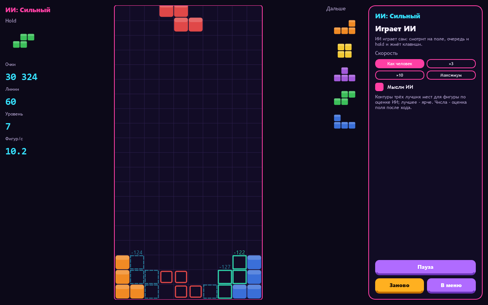
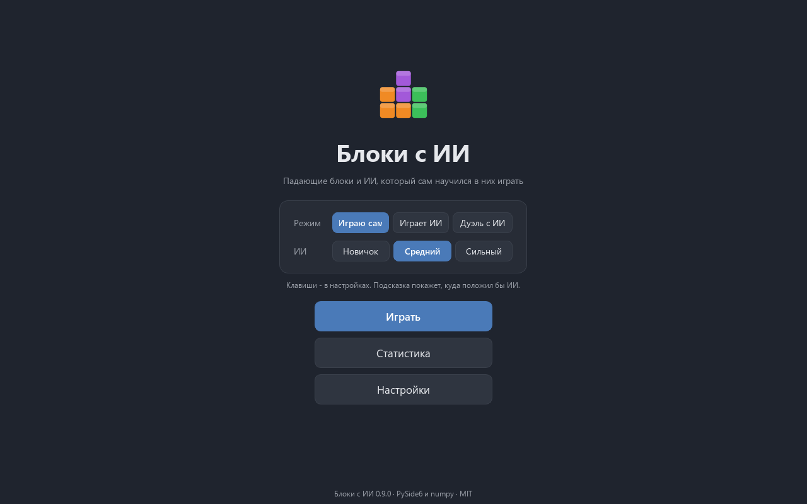
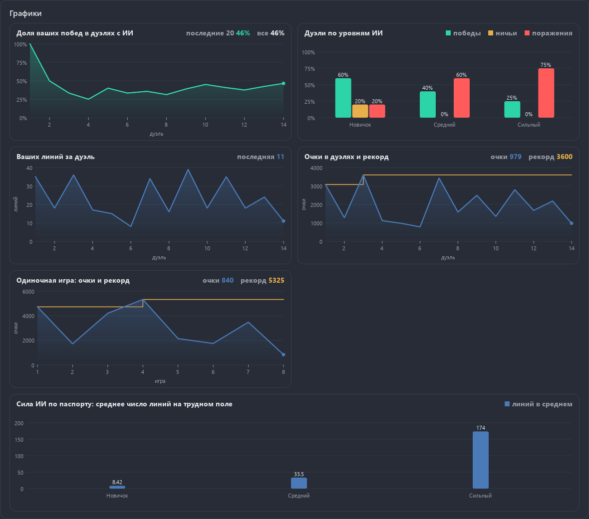

<div align="center">

# Block Drop AI

**A falling-blocks game in the classic style, with an AI that taught itself to play. Play yourself, watch the AI, or duel it.**

[Русская версия](README.ru.md)

[](#) [](https://github.com/ALEXalesha/BlockDropAi/releases/latest) [](https://github.com/ALEXalesha/BlockDropAi/actions/workflows/ci.yml) [](LICENSE) [](https://www.python.org/) [](https://doc.qt.io/qtforpython-6/) [](https://claude.com/claude-code)

Code, tests and docs are written by Claude (Anthropic) in Claude Code. Ideas, testing and decisions - Alexey.



</div>

Python, PySide6 and numpy. No pygame, no PyTorch.

## Modes

- **I play.** Classic falling blocks: five next pieces, hold, ghost piece. The **Hint** button shows where the AI would put the piece.
- **AI plays.** Pause, speed from human-like to maximum, line counter.
- **Duel with the AI.** Two boards side by side. Cleared lines send garbage rows to the opponent (2 lines send 1, 3 send 2, 4 send 4). The AI thinks no faster than a set number of pieces per second for its level.
- **AI thoughts** (a switch in every mode): outlines of the AI's three best spots for the current piece with their scores; the best one is brighter.

## Rules

- A 10 × 20 board plus hidden rows above it.
- 7 pieces from a "bag of 7": every 7 pieces in a row are all different, in random order.
- SRS rotation with wall kicks, both directions. The kick tables are computed from the SRS offset data and checked against the standard tables in the tests (including a T-spin triple that needs the fifth kick).
- Soft and hard drop, a 0.5 s lock delay that movement can postpone 15 times, hold once per piece.
- 100 / 300 / 500 / 800 points for 1-4 lines, times the level; the level and speed rise every 10 lines.
- Game time comes from the clock, not from the frame rate: the same seconds give the same game at 30 or 144 frames per second.

## How the AI plays

The AI looks at the same things a player sees: the board, the current piece, the five next pieces and hold. It tries every spot where the piece can land and scores the board after each move ("evaluation after the move").

**Finding the spots.** A search over piece states (rotation, column, row) finds every reachable spot, including tucks under overhangs and T-spins, and the key presses that lead there. The AI then plays with those keys through the real game. It never teleports a piece. A law test plays the keys in a real game and checks that the piece lands exactly where the search promised.

**Scoring the board.** Two variants were built and compared:

1. **Feature weights tuned by the cross-entropy method (CEM).** Features: landing height, eroded cells, row and column transitions, holes, rows with holes, cumulative wells, bumpiness, total and maximum height, cleared lines. A population of weight sets plays, and the best ones define the next generation.
2. **A small numpy network trained by TD** in self-play, with the same features plus the column heights.

The program uses the CEM weights.

**Levels:**

- **novice**: early weights (after the first generation);
- **medium**: final weights, no look-ahead;
- **strong**: final weights, look-ahead at the next piece (two moves deep) and hold.

## AI strength (model passport)

`python -m game.train passport`, seeded games, stored in `game/models/blockdrop-cem.json`; the tests replay a small sample.

**Normal game** (bag of 7, 20 rows), 100 games per level, each until game over or the line cap:

| Level | Mean lines | Median | Reached the cap |
|---|---|---|---|
| Novice | 47.7 | 43.5 | 0 / 100 (cap 10 000) |
| Medium | 10 000 | 10 000 | 100 / 100 (cap 10 000) |
| Strong | 20 000 | 20 000 | 100 / 100 (cap 20 000) |

Medium and strong never lose on the normal board, so the caps decide those rows.

**Hard test** (uniformly random pieces without the bag, board cut to 6 rows), 100 games per level:

| Level | Mean lines | Median |
|---|---|---|
| Novice | 8.4 | 7 |
| Medium | 33.5 | 20 |
| Strong | 173.7 | 100.5 |

**Level duels**, 20 per pair, same pieces for both, until one loses or 1 500 pieces each: medium beats novice 20 : 0, strong beats novice 20 : 0. Medium against strong: all 20 duels reached the piece cap without a loss, and medium sent slightly more garbage (for example 103 rows against 99), so it is listed as 20 : 0. The weights were trained to survive, not to attack, and look-ahead does not add attack.

## Menu and look

A start menu of its own - a **neon arcade hall**: a perspective floor grid runs towards you, glowing pieces fall and turn on both sides, and in the middle there is a title with every letter in the colour of its own piece, neon pill toggles and chunky three-colour arcade buttons. The light theme is a candy hall. The well, the score digits and the game side panel share its colours, like an arcade cabinet screen. The menu grows with the window up to 4K; the falling pieces never cross the buttons. Settings span the whole window, like the statistics.



## Statistics charts

Charts from the shared `aikit.charts`: your share of wins in duels with the AI (last 20 and all), duels by AI level, your lines and score per duel with the record, the solo score with the record, and the AI strength from the passport (mean lines on the hard board, where all levels share one limit). With no games yet a chart says in words what will appear.

A solo game with a Hint or AI thoughts does not count for records or charts (as in Minesweeper): the side panel reminds you during the game, and at the end the status says so.



## Keys

Arrows move and rotate, Space is hard drop, Z rotates counter-clockwise, C is hold, Esc pauses. Every key can be reassigned in Settings, together with the auto-repeat delay and rate (DAS/ARR).

## Download

Windows builds (installer and portable archive) are in [Releases](../../releases). The builds are not code-signed, so SmartScreen may warn on first start.

## Run

```
pip install -r requirements.txt
python main.py
```

Training is started by command only, with a limited number of threads:

```
python -m game.train cem --trial            # two generations and a time forecast
python -m game.train cem --gens 30 --workers 2
python -m game.train td --trial
python -m game.train export                 # CEM weights into game/models
python -m game.train passport --trial       # passport time forecast
python -m game.train passport --workers 2
```

## Tests

`python -m pytest -q`: rules, search, features, training, the AI player, the passport and the window (Qt offscreen, no visible windows). `python tools/mutate.py` breaks the code on purpose and checks that the tests catch every break. 288 checks and 69 mutants, all caught. Menu laws (`tests/test_menu.py`): the menu and the side panel are whole from the smallest window to 4K in both themes and languages, the background pieces never cross the buttons, settings take the full width.

## License

MIT, see [LICENSE](LICENSE).
